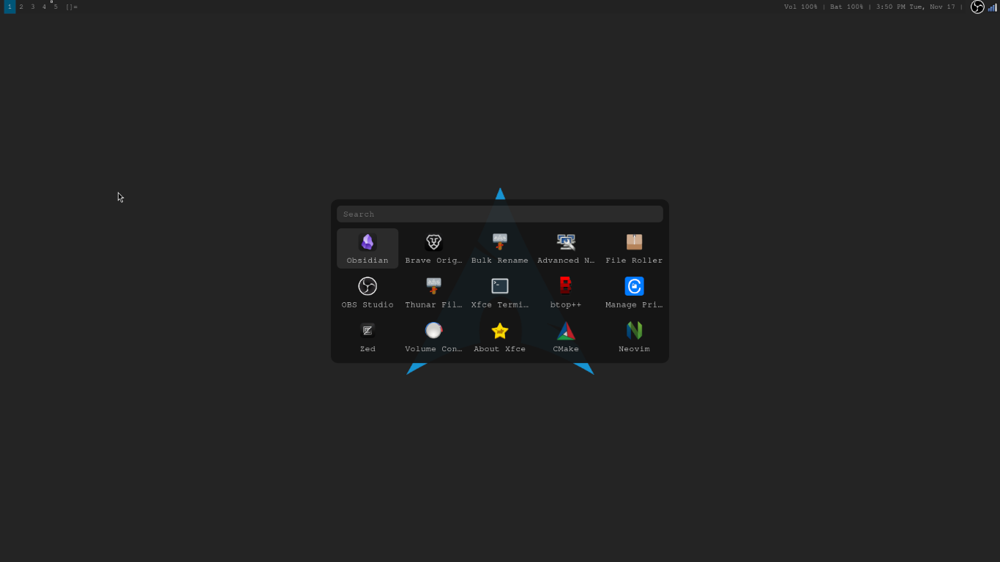
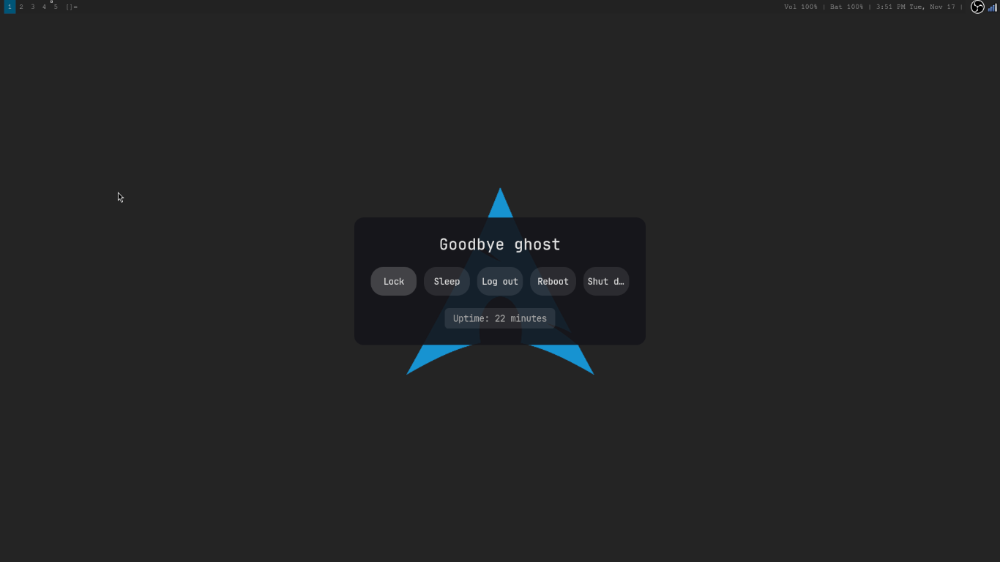

# dwm-dotfiles

A tiny, fast Linux desktop for old computers: the dwm window manager with a top bar, app launcher, notifications, Wi-Fi icon and sound. Tested on Arch Linux. Debian, Ubuntu and Mint are supported but tested less.

## Quick start

1. Install git: `sudo pacman -S git` (Arch) or `sudo apt install git` (Debian, Ubuntu).
2. Run: `git clone https://github.com/imhameed-dev/dwm-dotfiles.git && cd dwm-dotfiles && ./install.sh`
3. Install Brave Origin (see [docs/MANUAL.md](docs/MANUAL.md)), then log in on the text screen. The desktop starts by itself, or type `startx`.

## What you need

- A normal user account with `sudo`, and an internet connection for the install.
- Arch Linux (tested) or Debian, Ubuntu or Mint (supported, tested less).
- The desktop is built for low-RAM computers. Its total memory use has not been measured yet, so no number is given here.
- The installer upgrades the whole system on Arch (`pacman -Syu`). Run `./install.sh --dry-run` first to see everything it would do. Nothing is changed in that mode.

## Change it, update it, remove it

- **Change settings:** keys, colours, gaps and the browser are in `dwm/config.h`. After editing, rebuild as shown in [docs/MANUAL.md](docs/MANUAL.md) and press Super+Shift+R.
- **Update:** run `git pull`, then `./install.sh` again. Files you changed by hand in `~/.bashrc`, `~/.bash_profile`, `~/.xinitrc` and `~/.Xresources` are kept unless you add `--dotfiles`. Any other file that differs is saved first in `~/.local/state/dwm-dotfiles/backups`.
- **Check:** `./install.sh --check` only looks and changes nothing.
- **Remove:** run `./install.sh --dry-run --uninstall` to see the list, then `./install.sh --uninstall`. Files you edited are kept, and your old files can be put back from the backups. Programs stay installed.

## Documents

- [docs/MANUAL.md](docs/MANUAL.md): short manual for people (install, keys, change the browser, fixes).
- [docs/SHORTCUTS.md](docs/SHORTCUTS.md): every keyboard and mouse shortcut and what it does.
- [docs/AI.md](docs/AI.md): full guide for AI assistants. If you ask an AI to install or change this system, give it this file first.

## Screenshots

The desktop, the app launcher (Super+Space), the wallpaper menu (Super+W), the power menu (Super+Shift+S), and a terminal (Super+Enter) running `fastfetch`.

## Licences

- **dwm** (folder `dwm/`) and the rest of this repo: MIT/X Consortium licence, see [LICENSE](LICENSE).
- **dwmblocks** (folder `dwmblocks/`): GPL-2.0, see [dwmblocks/COPYING](dwmblocks/COPYING). It is based on an upstream dwmblocks program, and this repo does not record which one. The two possible upstreams use different licences (Luke Smith's version is GPL-2.0, the original by torrinfail is ISC), so the stricter one is used here. If you know where it came from, please open an issue.
- **Wallpaper pictures** (folder `wallpapers/`) belong to their original artists and are not covered by the licence above.
- Programs this repo installs (rofi, picom, dunst, Thunar and others) keep their own licences.
