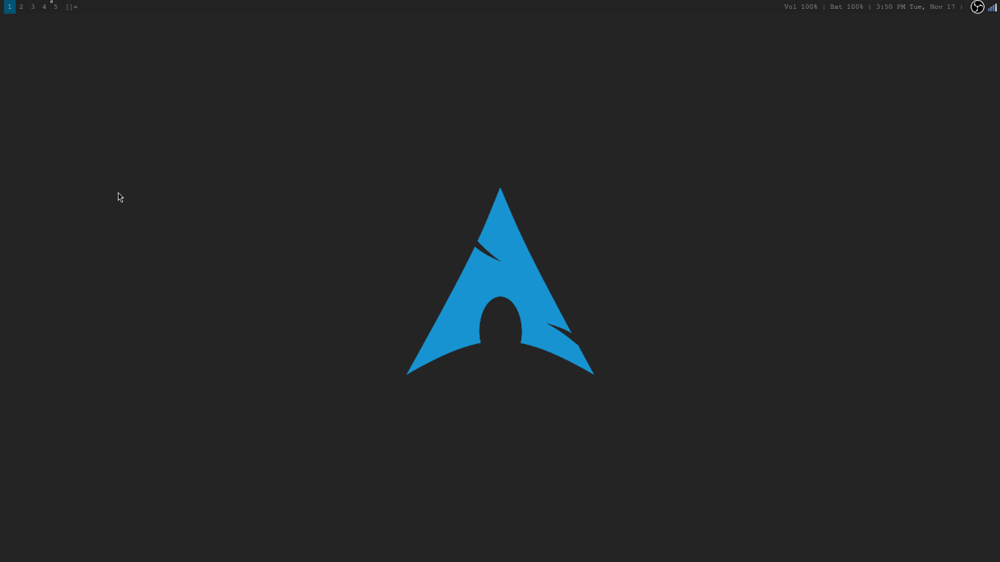
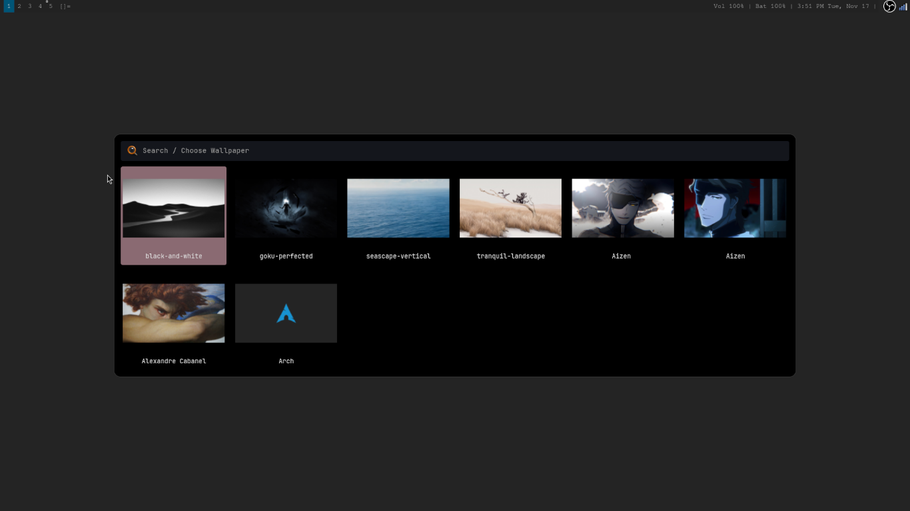
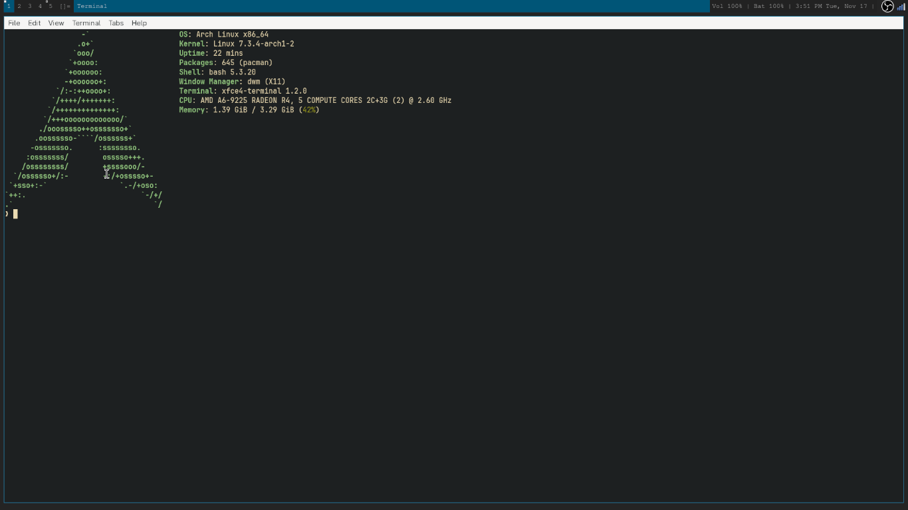

# dwm-dotfiles

A tiny, fast Linux desktop for old computers: the dwm window manager with a top bar, app launcher, notifications, Wi-Fi icon and sound. Tested on Arch Linux. Debian, Ubuntu and Mint are supported but tested less.

## Quick start

1. Install git: `sudo pacman -S git` (Arch) or `sudo apt install git` (Debian, Ubuntu).
2. Run: `git clone https://github.com/imhameed-dev/dwm-dotfiles.git && cd dwm-dotfiles && ./install.sh`
3. Install Brave Origin (see [docs/MANUAL.md](docs/MANUAL.md)), then log in on the text screen. The desktop starts by itself, or type `startx`.

## Documents

- [docs/MANUAL.md](docs/MANUAL.md): short manual for people (install, keys, change the browser, fixes).
- [docs/SHORTCUTS.md](docs/SHORTCUTS.md): every keyboard and mouse shortcut and what it does.
- [docs/AI.md](docs/AI.md): full guide for AI assistants. If you ask an AI to install or change this system, give it this file first.

## Screenshots

The desktop, the app launcher (Super+Space), the wallpaper menu (Super+W), the power menu (Super+Shift+S), and a terminal (Super+Enter) running `fastfetch`.

